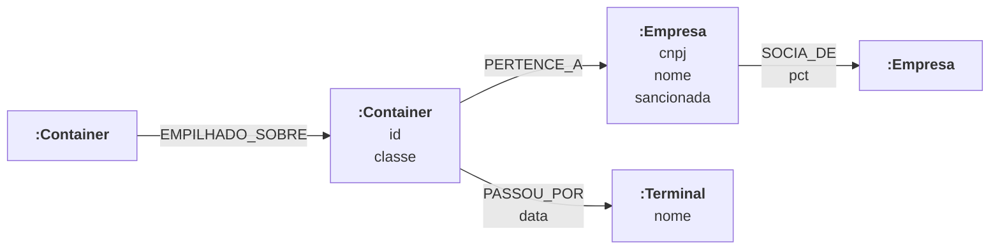
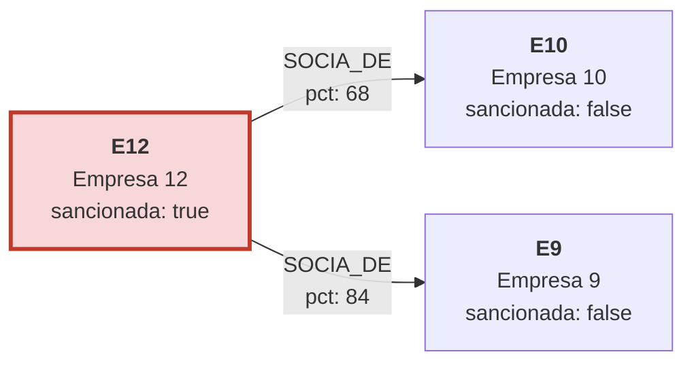

# C1 — Modelo do grafo do LogiPorto

## Modelo



## Legenda

**Nós**

| rótulo | propriedades | exemplo |
|---|---|---|
| Empresa | cnpj, nome, sancionada | `{cnpj: "E12", nome: "Empresa 12", sancionada: true}` |
| Container | id, classe | `{id: "K0", classe: "Granel"}` |
| Terminal | nome | `{nome: "T2"}` |

**Arestas**

| relacionamento | direção | significado | propriedades |
|---|---|---|---|
| SOCIA_DE | Empresa → Empresa | a empresa de onde sai a seta tem `pct`% da empresa onde a seta chega | pct |
| PERTENCE_A | Container → Empresa | o contêiner é dessa empresa | nenhuma |
| PASSOU_POR | Container → Terminal | o contêiner passou por esse terminal nessa data | data |
| EMPILHADO_SOBRE | Container → Container | o contêiner de onde sai a seta está em cima do outro | nenhuma |

Aqui não tem chave estrangeira nem tabela associativa. Num banco relacional a sociedade entre empresas seria uma tabela N:M, tipo `socios(empresa_a, empresa_b, pct)`, e a passagem pelo terminal seria outra, `passagens(container, terminal, data)`. No grafo essas ligações são as próprias arestas, e o `pct` e a `data` ficam guardados nelas. O contêiner também não tem um campo `dono`: ele aponta direto pra empresa com PERTENCE_A.

## Subgrafo real da minha empresa sancionada

A EMPRESA_SANCIONADA da minha prova é a **E12**. Consultei os sócios diretos nos dois sentidos com `neo4j/c1_subgrafo.cypher` (saída em `neo4j/saidas/c1_subgrafo.txt`):

```
socia, participada, pct
"E12", "E10", 68
"E12", "E9", 84
```



A E12 é sócia de duas empresas: tem 68% da E10 e 84% da E9. Nenhuma empresa aparece como sócia da E12, ou seja, no meu grafo não tem seta chegando nela.

A E12 também tem 10 contêineres: K0, K1, K2, K34, K36, K44, K51, K58, K61 e K87. Não coloquei todos no desenho pra não poluir.
